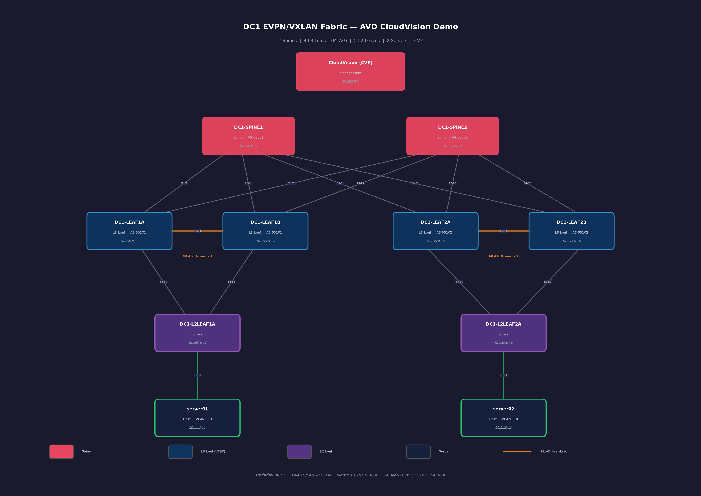

# AVD Demo — DC1 Fabric

Arista Validated Design (AVD) demo for deploying and managing a DC1 leaf-spine fabric via CloudVision Portal (CVP).

## Topology

- **2 Spines:** DC1-SPINE1, DC1-SPINE2
- **4 L3 Leafs:** DC1-LEAF1A, DC1-LEAF1B, DC1-LEAF2A, DC1-LEAF2B
- **2 L2 Leafs:** DC1-L2LEAF1A, DC1-L2LEAF2A
- **CVP Server:** 10.18.146.238



## Project Structure

```
├── ansible.cfg              # Ansible configuration
├── inventory.yml            # Device inventory (spines, leafs, CVP)
├── group_vars/
│   ├── DC1.yml              # Global settings (users, TerminAttr, DNS)
│   ├── DC1_FABRIC.yml       # Fabric design (BGP, MLAG, interfaces)
│   ├── DC1_SERVERS.yml      # Server-facing port profiles
│   └── DC1_TENANTS_NETWORKS.yml  # VRFs, VLANs, SVIs
├── playbooks/
│   ├── dc1-fabric-deploy-cvp.yml   # Build + deploy configs via CVP
│   ├── dc1-fabric-reset-cvp.yml    # Reset fabric on CVP
│   └── dc1-validate-state.yml      # ANTA fabric validation
└── demo/scripts/
    ├── reset_cvp.py         # CVP reset helper
    └── validate_fabric.py   # Fabric validation helper
```

## Quick Start

```bash
# Generate configs only
make build

# Push configlets to CVP (no execution)
make provision

# Full deploy: build + provision + execute tasks
make deploy

# Validate fabric state
make validate

# Reset fabric on CVP
make reset
```

## Requirements

- Python 3.x
- Ansible
- [arista.avd](https://avd.arista.com/) collection
- [arista.cvp](https://cvp.avd.sh/) collection
- Access to CVP instance and EOS devices
